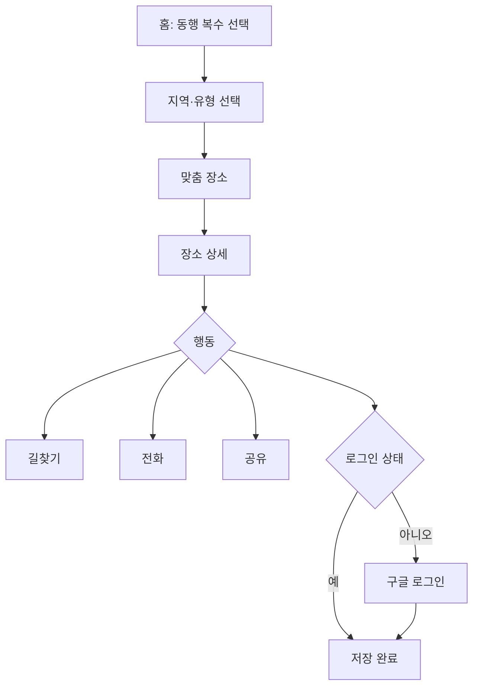

# 05. 화면과 사용자 흐름

기준 폭은 390px이고 최소 320px까지 지원한다. PC에서는 최대 폭 480px 중앙 레이아웃으로 보여주되, 관리자 화면만 넓게 쓴다.

## 라우트

| 경로 | 화면 | 로그인 |
|---|---|---|
| `/[locale]` | 홈, 동행 선택 | 아니오 |
| `/[locale]/plan` | 지역·유형 선택 | 아니오 |
| `/[locale]/results` | 맞춤 장소 목록·지도 | 아니오 |
| `/[locale]/places/[slug]` | 장소 상세 | 아니오 |
| `/[locale]/saved` | 저장 목록 | 예 |
| `/[locale]/login` | 로그인 | 아니오 |
| `/[locale]/about` | 정보 확인 방식, 문의 | 아니오 |
| `/[locale]/privacy` | 개인정보 처리방침 | 아니오 |
| `/admin/*` | 관리자 | 관리자 |

결과 URL 예시:

```text
/ko/results?with=kids,senior&region=east,south&type=restaurant,cafe
```

## 전체 흐름



## 1. 홈

**구성**
- 상단: 로고 '같이제주', 저장 목록, 언어 선택, 테마 전환
- 슬로건, 보조 문구 "아이·반려견·어르신 동행에 맞는 장소를 찾아드려요"
- 제주 일러스트
- 동행 버튼 3개: 아이와 함께, 반려견과 함께, 실버와 함께
- 안내 문구 또는 선택 개수
- 하단 고정 '다음'

**상호작용**
- 버튼 선택 시 체크 표시와 윤곽선을 표시한다.
- 시안의 `>` 아이콘은 체크 상태 표시로 바꾼다.
- 저장 목록은 로그인 여부와 상관없이 상단에서 들어갈 수 있다.

## 2. 지역·유형 선택

**구성**
- 뒤로 가기, 현재 동행 요약
- 단계 표시: 동행 선택, 지역 선택, 장소 선택
- "어디로 떠나세요?" 권역 사진 카드 4개
- "어떤 장소를 찾을까요?" 숙소, 식당, 카페 토글
- 하단 고정 '맞춤 장소 보기'

**상태**
- 지역 미선택: 버튼 비활성
- 유형 전체 해제: 버튼 비활성, 안내 표시

## 3. 맞춤 장소

**구성**
- 제목 '맞춤 장소', 저장 목록 이동
- 삭제 가능한 조건 칩
- 필터 시트 버튼, 결과 수
- 판정 설명 한 줄: "선택한 동행 모두를 기준으로 확인했어요"
- 장소 카드 목록
- 하단 고정: 전체 저장, 지도로 보기

**카드 구성**

```text
[사진] 돌담식당                       >
       표선면
       ● 맞음
       [아기 의자] [맵지 않은 메뉴] [1층]
       2026.11.03 확인
```

**상태**

| 상태 | 표시 |
|---|---|
| 로딩 | 카드 스켈레톤 |
| 결과 없음 | 어떤 조건이 원인인지 안내하고 지역·필터 완화 버튼 제공 |
| 네트워크 오류 | 다시 시도 |
| 맞지 않음 포함 | 카드에 이유 표시 |

## 4. 장소 상세

**순서**
1. 사진과 저장 버튼
2. 이름, 유형, 읍면동
3. 일행 판정 요약
4. 동행별 확인 사항
5. 전화, 길찾기, 공유 버튼
6. 영업 정보, 포장, 가격대
7. 지도
8. 대체 장소
9. 근거와 확인 방식, 오류 신고

**동행별 카드 예시**

```text
반려견                              조건부
✓ 테라스 동반 가능       전화 확인 · 2026.11.03
△ 실내 불가              전화 확인 · 2026.11.03
✓ 12kg 이하              전화 확인 · 2026.11.03
```

**길찾기 시트**
- 한국어: 카카오맵, 네이버지도, 구글 지도 순서
- 그 외 언어: 구글 지도, 카카오맵, 네이버지도 순서

## 5. 로그인

- 왜 로그인이 필요한지 한 문장으로 설명
- '구글로 계속하기'
- 로그인 없이 계속 보기
- 인앱 브라우저에서는 구글 버튼 대신 다음 안내:
  - "카카오톡 안에서는 구글 로그인이 어려워요. Chrome이나 Safari에서 열어 주세요."
  - 링크 복사 버튼
  - Android에서 가능한 경우 외부 브라우저 열기 버튼

## 6. 저장 목록

- 유형별 탭
- 저장 장소 카드
- 비어 있을 때 첫 화면으로 이동
- 폐업·휴업은 표시를 유지하고 '영업 안 함'으로 안내
- 저장 뒤 조건 정보가 바뀐 장소에 변경 표시

## 7. 오류 신고

- 바텀 시트
- 항목 선택: 입장 조건, 영업 정보, 시설, 폐업, 기타
- 설명 입력
- 제출 후 "확인해 볼게요"

## 8. 관리자

| 화면 | 기능 |
|---|---|
| 대시보드 | 게시 수, 권역 할당량, 재확인 임박, 신고 수 |
| 장소 목록 | 권역, 유형, 상태, 기한 초과 필터 |
| 장소 편집 | 기본 정보, 항목 값, 번역, 사진, 미리보기, 게시 |
| 전화 확인 | 통화 스크립트와 입력 폼 |
| 재확인 대기열 | 기한순, 오늘 확인 처리 |
| 신고 대기열 | 처리 중, 반영, 반려 |
| 변경 이력 | 누가 언제 무엇을 바꿨는지 |

## 문구 원칙

- 친근하되 과장하지 않는다.
- 판정은 사실로 표현한다. "완벽해요" 대신 "모든 동행이 이용 가능해요"
- 미확인은 "아직 확인하지 못했어요"로 쓰고 전화 버튼을 함께 준다.
- 시안의 '실버와 함께'는 유지한다. 상세 조건은 '입식 좌석', '계단 없음'처럼 표현한다.
