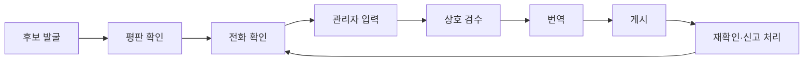

# 08. 데이터 운영

이 제품의 핵심 자산은 코드가 아니라 **확인된 조건값과 그 신선도**다. 베타는 운영진이 직접 입력한다.

## 베타 할당량

| 권역 | 식당 | 카페 | 숙소 | 합계 |
|---|---|---|---|---|
| 동부 | 25 | 15 | 10 | 50 |
| 서부 | 25 | 15 | 10 | 50 |
| 남부 | 25 | 15 | 10 | 50 |
| 북부 | 25 | 15 | 10 | 50 |
| 합계 | 100 | 60 | 40 | 200 |

한 권역 안에서 세 동행이 모두 결과를 볼 수 있도록 균형을 맞춘다. 게시 전 다음 수량을 권역별로 확인한다.

- 아이 이용 가능: 20곳 이상
- 반려견 이용 가능: 15곳 이상
- 입식 또는 혼합 좌석이고 계단 없는 곳: 20곳 이상
- 세 동행 모두 맞음 또는 조건부: 5곳 이상

위 수량은 빈 결과를 막기 위한 시작값이다. 실제 공급을 보고 조정한다.

## 수집 흐름



## 후보 발굴

- 공공 시드: 식약처 반려동물 동반 업소, 비짓제주 혼저옵서개, 예스키즈존, 무장애 공공데이터
- 운영진이 직접 아는 곳
- 사용자 제보

사람이 지도 앱과 커뮤니티를 직접 읽고 평판을 판단할 수 있다. 다만 후기 원문, 평점, 플랫폼 좌표를 저장하지 않는다. 공공 목록은 후보로만 쓰고 공개 전 다시 확인한다.

## 전화 확인 스크립트

```text
안녕하세요. 제주 여행 정보 서비스 같이제주입니다.
아이, 반려견, 어르신과 함께 오는 여행객이 미리 확인할 수 있도록
매장 이용 조건을 무료로 안내하고 있습니다. 광고 문의가 아닙니다.
몇 가지만 여쭙고, 답해 주신 내용을 앱에 공개해도 될까요?
```

**공개 동의를 받은 뒤 묻는다.**

1. 지금 정상 영업 중인가요? 정기 휴일이 있나요?
2. 어린이 입장에 나이나 공간 제한이 있나요?
3. 아기 의자는 몇 개인가요? 맵지 않은 메뉴가 있나요? 이유식이나 간식을 가져와도 되나요?
4. 반려견은 실내까지 가능한가요, 야외만 가능한가요?
5. 크기나 무게 제한, 이동장, 접종 증명 조건이 있나요?
6. 좌석은 입식, 좌식, 혼합 중 어떤 형태인가요?
7. 입구에 계단이나 턱이 있나요? 2층 이상이면 엘리베이터가 있나요?
8. 주차장에서 입구까지 가깝나요? 화장실은 어디에 있나요?
9. 숙소라면 가족 객실, 반려견 객실, 추가 요금, 침대 여부도 묻는다.
10. 포장이 가능한가요?

거부하면 입력하지 않고 공개하지 않는다. 통화 내용은 사실 항목만 기록하고 녹음하지 않는다.

## 입력 규칙

- 들은 그대로 항목을 고르고 애매하면 `unknown`으로 둔다.
- 메모는 '주말 저녁은 2층 좌석만 가능'처럼 짧은 사실로 쓴다.
- 없는 메뉴나 시설을 추측하지 않는다.
- 같은 장소를 입력한 사람과 다른 운영진이 게시 전에 검수한다.
- 민감한 평가, 업주 개인 의견, 분쟁 내용은 적지 않는다.

## 재확인 주기

| 묶음 | 주기 | 실패 시 |
|---|---|---|
| 정책 | 90일 | '확인 오래됨', 180일 초과 시 판정 미확인 |
| 운영 | 60일 | 상세에서 전화 권장 |
| 물리 | 365일 | 확인일 강조 |

주기는 근거 수치가 아닌 시작값이다. 재확인할 때 값 변경 비율을 기록해 조정한다.

## 신고 처리

| 우선순위 | 유형 | 목표 |
|---|---|---|
| 높음 | 폐업, 입장 거절 | 영업일 1일 이내 확인 |
| 보통 | 영업시간, 메뉴 | 영업일 3일 이내 |
| 낮음 | 기타 | 주간 처리 |

신고는 공개 데이터를 자동으로 바꾸지 않는다. 다시 확인한 뒤 고친다. 입장 거절 신고는 확인 전이라도 해당 판정을 숨기거나 '재확인 중'으로 바꿀 수 있다.

## 사진 정책

- 운영진이 촬영했거나 업주가 사용을 허락한 사진만 쓴다.
- 사람 얼굴과 차량 번호가 식별되면 쓰지 않는다.
- 사용 근거를 관리자 화면에 기록한다.
- 지도 앱, 블로그, 인스타그램 사진을 쓰지 않는다.

## 번역 운영

- 번역 대상 자유 텍스트를 최소화한다.
- AI 초안을 만들고 관리자 화면에 `draft`로 기록한다.
- 중요한 메모는 검수 후 `reviewed`로 바꾼다.
- 초안 번역이면 사용자에게 자동 번역 안내를 표시한다.

## 운영 부담 추정

전화 1건 5분, 재시도 없음 가정이다. 첫 입력 200곳은 약 17시간이다. 운영·정책 항목을 재확인하면 분기당 같은 수준의 시간이 추가로 든다. 실제 소요 시간은 초기 20곳에서 측정해 다시 계산한다. 숙소는 질문이 많고 연결이 어려울 수 있어 더 걸릴 수 있다.

## 법무·정책 점검

- [ ] 카카오맵 API 사용 조건과 표시 의무
- [ ] 공공데이터별 상업 이용 조건
- [ ] 개인정보 처리방침과 구글 로그인 안내
- [ ] 광고 도입 시 표시 의무
- [ ] 반려동물 동반 음식점 제도의 최신 기준
- [ ] 업소명, 전화번호 공개 방식
