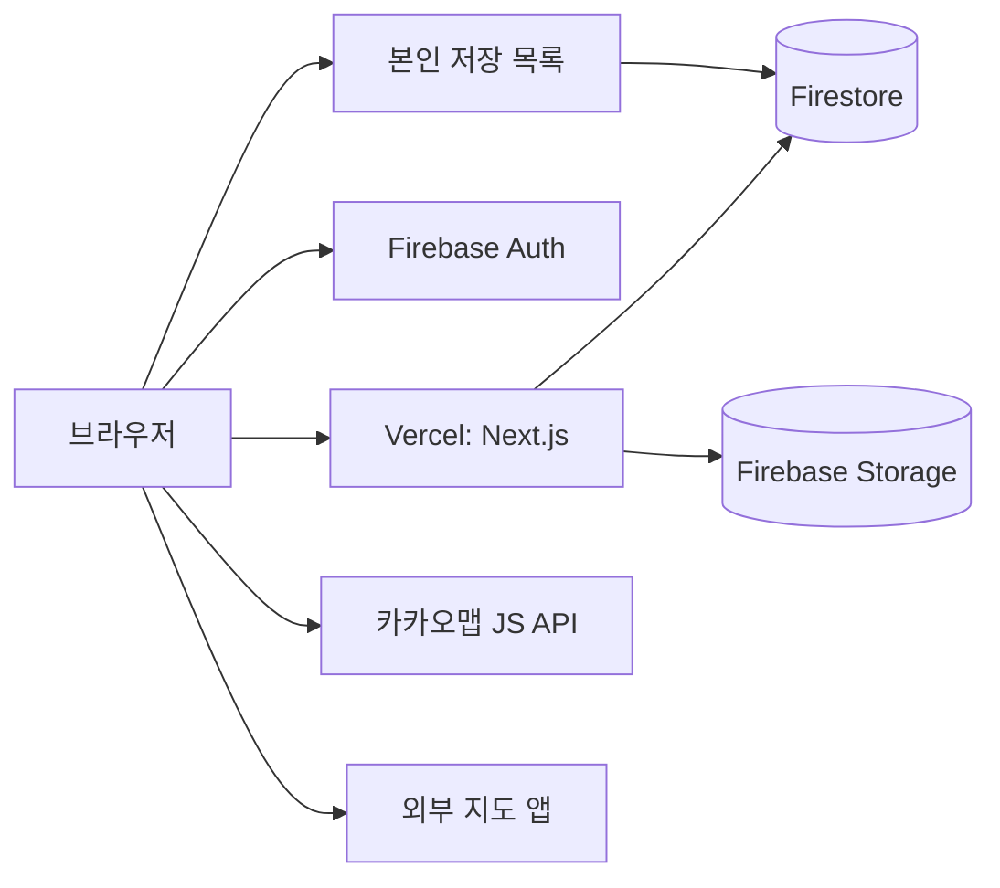

# 09. 기술 구조

## 전체 구조



## 핵심 설계

- **공개 장소:** 서버 컴포넌트가 `firebase-admin`으로 읽고 캐시한다. 200곳 규모이므로 게시 장소 전체를 캐시해 서버 메모리에서 판정과 필터를 처리한다.
- **저장 목록:** 클라이언트 SDK가 본인 경로만 읽고 쓴다.
- **관리자 쓰기:** Server Action에서 세션과 권한을 검증한 뒤 Admin SDK로 쓴다.
- **캐시 갱신:** 관리자가 게시·수정하면 `revalidateTag('places')`를 호출한다.

이 구조는 Firestore의 복합 조건과 부정 조건 제약을 피한다. 업소가 크게 늘면 검색 전용 인덱스 도입을 검토한다.

## 폴더 구조

```text
src/
  app/
    [locale]/
      page.tsx
      plan/page.tsx
      results/page.tsx
      places/[slug]/page.tsx
      saved/page.tsx
      login/page.tsx
      about/page.tsx
      privacy/page.tsx
    admin/
    api/
    globals.css
  components/
    ui/
    place/
    filter/
    admin/
  lib/
    firebase/
      client.ts
      admin.ts
    verdict/
      evaluate.ts
      evaluate.test.ts
    places/
      repository.ts
      filters.ts
    freshness/
    maps/
      kakao.ts
      deeplinks.ts
    auth/
      in-app-browser.ts
      session.ts
  i18n/
    routing.ts
    request.ts
  messages/
    ko.json
    en.json
    zh.json
    ja.json
  middleware.ts
scripts/
  grant-admin.ts
  seed-places.ts
  validate-places.ts
firestore.rules
storage.rules
```

## 인증

### 일반 사용자

- Firebase Auth Google 제공자를 쓴다.
- 일반 브라우저에서는 `signInWithPopup`, 팝업이 막히면 `signInWithRedirect`로 전환한다.
- 로그인 전 저장하려던 `placeId`를 `sessionStorage`에 넣고 복귀 후 처리한다.

### 인앱 브라우저

구글은 임베디드 웹뷰의 OAuth를 차단할 수 있다. 공유 링크가 카카오톡 안에서 열리면 로그인에 실패할 수 있으므로 호출 전에 사용자 에이전트를 검사한다.

```ts
const IN_APP = /KAKAOTALK|NAVER|Instagram|FBAN|FBAV|Line\//i;
export const isInAppBrowser = (ua: string) => IN_APP.test(ua);
```

인앱 브라우저라면 로그인 버튼 대신 외부 브라우저 안내를 보여준다. 탐지 목록은 실기기에서 검증한다.

### 관리자

- 허용된 구글 계정에만 Custom Claim `admin=true`를 부여한다.
- `scripts/grant-admin.ts`를 운영자가 직접 실행한다.
- `/admin`은 서버에서 세션 쿠키를 `verifySessionCookie`로 검증한다.
- 관리자 Server Action마다 권한을 다시 확인한다.
- 관리자 쓰기는 `auditLogs`에 기록한다.

## Firestore 보안 규칙

```text
rules_version = '2';
service cloud.firestore {
  match /databases/{database}/documents {
    match /places/{id} { allow read, write: if false; }
    match /reports/{id} { allow read, write: if false; }
    match /auditLogs/{id} { allow read, write: if false; }

    match /users/{uid} {
      allow read, write: if request.auth != null && request.auth.uid == uid;
      match /saved/{placeId} {
        allow read, write: if request.auth != null && request.auth.uid == uid;
      }
    }
  }
}
```

Admin SDK는 보안 규칙을 거치지 않으므로 서버 권한 검사를 반드시 수행한다. 저장 쓰기에 허용 필드와 개수 제한을 더해 규칙을 강화한다.

## 다국어

- `next-intl`과 `[locale]` 경로를 쓴다.
- 지원 언어: `ko`, `en`, `zh`, `ja`, 기본값 `ko`
- 언어별 `hreflang`과 메타데이터를 생성한다.
- 메시지 키 누락은 CI에서 검사한다.
- 날짜는 언어별 형식으로 보여준다.
- 조건 enum 키 예시:

```json
{
  "fact": {
    "pet.entry": {
      "indoor": "실내 동반 가능",
      "outdoor": "야외 좌석만 동반 가능",
      "no": "반려동물 동반 불가",
      "unknown": "아직 확인하지 못했어요"
    }
  }
}
```

## 테마

- `next-themes`로 시스템, 라이트, 다크를 지원한다.
- 토큰은 CSS 변수로 정의한다.

## 지도

- 카카오맵 JavaScript SDK를 동적으로 불러온다.
- 지도 화면과 상세 지도 영역이 보일 때만 로드한다.
- 앱 키는 공개되는 값이므로 카카오 개발자 콘솔에 허용 도메인을 등록한다.
- 로드 실패 시 주소와 외부 링크를 보여준다.

길찾기 링크는 `src/lib/maps/deeplinks.ts`에 모은다.

| 서비스 | 형식 | 비고 |
|---|---|---|
| 카카오맵 | `https://map.kakao.com/link/to/{이름},{위도},{경도}` | 공개 링크 형식 |
| 구글 지도 | `https://www.google.com/maps/dir/?api=1&destination={위도},{경도}` | 공개 링크 형식 |
| 네이버지도 | 앱 URL 스킴 + 웹 대체 링크 | 구현 시 공식 문서로 최종 확인 |

## API

| 경로 | 메서드 | 기능 |
|---|---|---|
| `/api/session` | POST, DELETE | 세션 쿠키 생성·삭제 |
| `/api/reports` | POST | 오류 신고, 제한 횟수 적용 |

읽기는 서버 컴포넌트를 쓰고, 관리자 쓰기는 Server Action을 쓴다.

## 환경 변수

```text
NEXT_PUBLIC_FIREBASE_API_KEY=
NEXT_PUBLIC_FIREBASE_AUTH_DOMAIN=
NEXT_PUBLIC_FIREBASE_PROJECT_ID=
NEXT_PUBLIC_FIREBASE_STORAGE_BUCKET=
NEXT_PUBLIC_FIREBASE_APP_ID=
FIREBASE_ADMIN_PROJECT_ID=
FIREBASE_ADMIN_CLIENT_EMAIL=
FIREBASE_ADMIN_PRIVATE_KEY=
NEXT_PUBLIC_KAKAO_MAP_KEY=
NEXT_PUBLIC_SITE_URL=
```

Vercel 프로젝트 환경 변수에 등록하고, 개발 키와 운영 키를 분리한다.

## 보안과 개인정보

- 신고 API에 입력 검증, 길이 제한, IP 기준 제한을 둔다.
- IP는 제한 처리에 필요한 기간만 쓰고 공개 데이터에 넣지 않는다.
- 공개 응답에서 `verifiedBy`, 내부 메모, 사진 동의 정보를 제거한다.
- 수집 항목은 구글 계정 식별자, 이메일, 저장 장소로 제한한다.
- Firebase App Check 적용을 검토한다.
- 신고 내용은 화면에 출력할 때 이스케이프한다.

## 성능 목표

- 모바일 LCP 2.5초 이내
- JavaScript는 화면별로 분리
- 이미지는 Next Image로 최적화
- 카카오맵은 지연 로드

## SEO

- 장소 상세를 서버 렌더링한다.
- `sitemap.xml`, `robots.txt`, 언어별 canonical을 생성한다.
- 공개 사실 범위에서 장소 구조화 데이터를 제공한다.
- `/admin`과 `/saved`는 색인을 막는다.

## 배포

- `main`: 운영, 그 외 브랜치: Vercel 미리보기
- PR마다 lint, typecheck, test, 메시지 키 검사를 실행한다.
- Firebase 규칙은 저장소에서 관리하고 배포 명령으로 반영한다.
- Firestore는 정기 내보내기로 백업한다.
